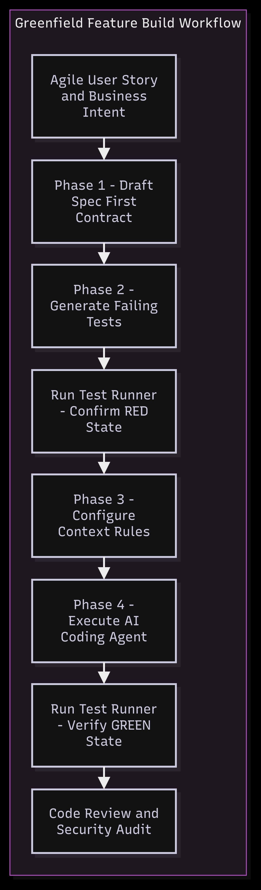
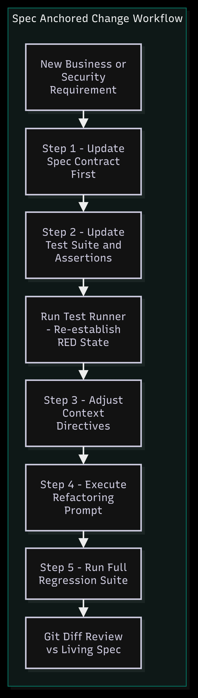
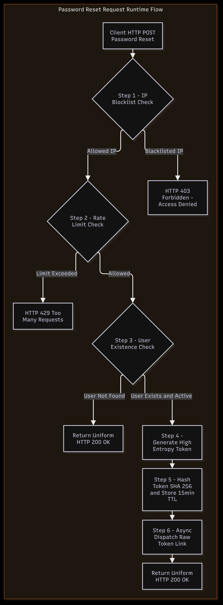

# IntentSpec: Spec-Driven Development & Context Engineering Framework

IntentSpec is an open-source engineering framework designed to bridge the gap between human business intent and non-deterministic AI code generation. By combining Spec-Driven Development (SDD) with Context Engineering, IntentSpec replaces chaotic vibe-coding with deterministic, test-verifiable software architecture.

---

## The Core Philosophy

When developers interact with AI coding assistants (Cursor, Windsurf, Claude Code, Cline/RooCode), three primary failure modes occur:
1. Scope Creep & Hallucination: AI agents invent unrequested features or make unverified assumptions about business logic.
2. Context Degradation & Token Waste: Flooding the AI model context window with irrelevant files leads to the lost-in-the-middle phenomenon and degraded reasoning.
3. Architectural Drift: Repeated ad-hoc prompt edits cause code to drift away from documentation and original security contracts.

IntentSpec enforces a Spec-Anchored Lifecycle: Code is never generated directly from unstructured natural language prompts. Instead, executable specifications (.spec.md) act as living contracts, automated tests (.test.ts) establish mathematical Red baselines, and context rules (.cursorrules) constrain agent memory.

---

## Repository Topology

An IntentSpec-compliant repository structures intent, verification, and rules alongside application code:

---

## 1. Greenfield Feature Build Workflow (Initial Development)

Building a new feature in IntentSpec follows a strict 4-phase progression:

  

### Phase Breakdown

| Phase | Responsibility | Key Deliverable / Gate |
| :--- | :--- | :--- |
| Phase 1: Spec Contract | Human Developer | .spec/SPEC-AUTH-001.md containing BDD scenarios, security parameters, and context limits. |
| Phase 2: Spec-TDD Baseline | Human Developer / AI | tests/unit/*.test.ts implementing assertions for all BDD scenarios (RED state). |
| Phase 3: Context Rules | Human Developer | .cursorrules defining file load rules, skeleton trimming, and token constraints. |
| Phase 4: AI Execution | AI Coding Agent | Implementation code in src/ to turn all tests GREEN. |

---

## 2. Spec-Anchored Change & Refactoring Workflow

When business requirements evolve (e.g., changing token expiration rules or adding IP security blocklists), changes flow through a 5-step refactoring loop to ensure documentation never lags behind code:

  

### The 5 Steps of Feature Evolution
1. Update Spec Contract First (.spec.md): Modify business rules, TTLs, and add new BDD scenarios to the spec file.
2. Update Test Suite (.test.ts): Add or update test assertions to reflect the new requirements. Run npm test to re-establish the RED failing state.
3. Adjust Context Directives (.cursorrules): Add any new service interface signatures or dependencies to the AI context rules.
4. Execute AI Refactoring Prompt: Direct the AI agent to make the updated test suite pass using the living spec contract.
5. Verification & Diff Review: Verify all tests pass (GREEN state) and inspect git diff to ensure zero scope creep.

---

## 3. Feature Runtime & Security Execution Flow

The reference implementation in this repository (SPEC-AUTH-001) demonstrates a production-grade Password Reset Request endpoint incorporating critical security mechanisms:

  

### Key Security Safeguards
* IP Security Blocklist: Intercepts blacklisted IPs before processing, returning 403 Forbidden.
* Rate Limiting: Restricts reset attempts to prevent DoS attacks, returning 429 Too Many Requests.
* User Enumeration Prevention: Returns identical 200 OK messages for both registered and unregistered email addresses.
* Token Security: Generates high-entropy reset tokens, stores only SHA-256 hashes in memory/DB with a strict 15-minute TTL, and dispatches the raw link via email.

---

## 4. Context Engineering Best Practices

IntentSpec manages the LLM token budget like premium real estate using five core rules defined in .cursorrules:

1. Relevance-First Selection: Only load files directly mentioned in the spec's Must-Load block.
2. Skeleton Trimming: Strip internal function bodies from imports, exposing only interface signatures to the model.
3. Phased Loading: Provide context in progressive stages (Spec -> Tests -> Code).
4. Targeted Isolation: Isolate independent modules so the AI cannot modify unrelated files.
5. No Spec Manipulation: The AI agent is strictly forbidden from modifying .spec.md or altering test assertions.

---

## Quick Start & Verification

### Prerequisites
* Node.js v18+
* npm v9+

### Installation & Setup

1. Clone the repository
2. Install dependencies: 
3. Run the automated test suite: 

### Example Test Output

